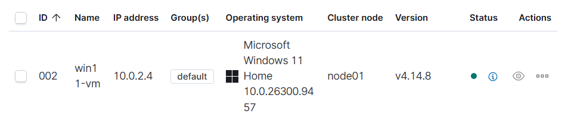
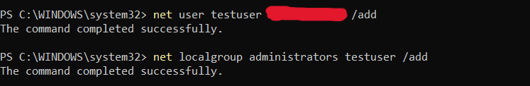
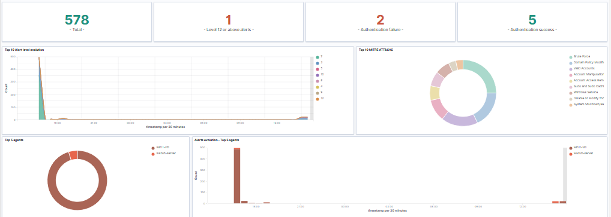
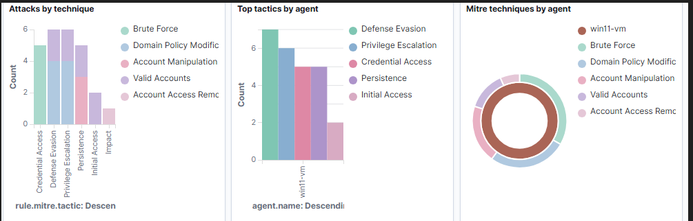

# Wazuh SOC Home Lab: Brute Force and Persistence Detection on Windows 11

A hands-on home lab in which I deployed Wazuh as a SIEM/XDR, simulated common attacker behaviour on a Windows 11 virtual machine, and investigated the resulting alerts the way a Tier 1 SOC analyst would. The lab covers agent deployment, log analysis, a custom detection rule, MITRE ATT&CK mapping and a written incident report.

> All activity was performed on my own isolated virtual machine, for learning purposes only.

## Objectives

- Deploy a working SIEM/XDR (Wazuh) and connect a Windows endpoint
- Simulate common attacker behaviour and observe how it appears in the logs
- Write and tune a custom detection rule
- Map detections to the MITRE ATT&CK framework
- Document the findings in a professional incident report

## Lab Environment

| Component | Details |
|-----------|---------|
| SIEM / XDR | Wazuh 4.14.8 (manager, indexer and dashboard on `wazuh-server`) |
| Monitored endpoint | Windows 11 Home VM, agent name `win11-vm` (agent ID 002, IP 10.0.2.4) |
| Hypervisor | Oracle VirtualBox |
| Detection content | Wazuh default Windows ruleset plus one custom rule (ID 100002) |



## Scenarios

### 1. Brute force (failed logons)

I locked the Windows session and entered an incorrect password several times. Windows logs each failed attempt as event ID 4625, which Wazuh's built-in rule 60122 picks up. My custom rule counts these events and raises a single higher-severity alert.

| Alert field | Value |
|-------------|-------|
| `timestamp` | Nov 14, 2026 @ 17:01:38.518 |
| `agent.name` | win11-vm |
| `rule.id` | 100002 |
| `rule.level` | 10 |
| `rule.description` | Custom Alert: A possible Brute Force attack was detected. |
| `rule.mitre.id` | T1110 |
| `data.win.system.eventID` | 4625 |
| `data.win.eventdata.targetUserName` | vboxuser (the VM's local account) |

<!-- TODO: add screenshot 05 (the opened rule 100002 alert), then uncomment the next line.

-->

### 2. Local account creation and privilege escalation

From an elevated PowerShell session I created a new local user and added it to the Administrators group, mimicking an attacker establishing persistence on a host.

```powershell
net user testuser <password> /add
net localgroup administrators testuser /add
```



Wazuh generated one alert for the account creation (event 4720) and two for group membership changes (event 4732): the automatic addition to the Users group and the manual addition to Administrators.


## Custom Detection Rule

```xml
<group name="windows, logon_failure, custom_rules">
  <rule id="100002" level="10" frequency="2" timeframe="60">
    <if_matched_sid>60122</if_matched_sid>
    <same_field>win.eventdata.targetUserSid</same_field>
    <description>Custom Alert: A possible Brute Force attack was detected.</description>
    <mitre>
      <id>T1110</id>
    </mitre>
  </rule>
</group>
```

| Field | Meaning |
|-------|---------|
| `if_matched_sid` 60122 | Builds on Wazuh's built-in "failed logon" rule (Windows event 4625) |
| `frequency` 2, `timeframe` 60 | Fires when the base rule matches 2 times within 60 seconds |
| `same_field` | The failures must target the same account SID, so attempts against different accounts are not mixed together |
| `level` 10 | Severity on Wazuh's 0-15 scale |
| `mitre` T1110 | Maps the alert to Brute Force |


**Tuning note:** I set a low threshold (2 failures) because the Windows account lockout stopped failed attempts from accumulating, so a higher value never fired reliably in the lab. In a production environment I would raise it to roughly 5-10 failures and add source IP and account context to cut down on false positives.

## Results

| Step | Windows Event ID | Wazuh Rule | Description | Level | MITRE ATT&CK |
|------|------------------|------------|-------------|-------|--------------|
| Failed logons | 4625 | 100002 (custom, built on 60122) | Custom Alert: A possible Brute Force attack was detected. | 10 | Brute Force (T1110) |
| New local user | 4720 | 60109 | User account enabled or created | 8 | Account Manipulation (T1098) |
| Added to Users group | 4732 | 60170 | Users Group Changed | 5 | n/a |
| Added to Administrators | 4732 | 60154 | Administrators Group Changed | 12 | Account Manipulation (T1098) |

**Key observation:** the failed logons were detected at 17:01:38. About three and a half minutes later (17:05:03) a new account was created, and it was elevated to administrator within about 52 seconds (17:05:55), so the whole chain took roughly four minutes. The Administrators group change was the only level 12 alert in the 24-hour window, which is exactly the kind of event a SOC analyst should prioritise.




Most of the alerts in the overview are low-severity baseline events generated when the agent first connected (including Security Configuration Assessment checks). The dashboard also lists techniques I did not intentionally trigger, such as Domain Policy Modification and Account Access Removal. I treat these as background noise for now and plan to investigate them in a later iteration.

## Full Incident Report

See [incident-report-brute-force.md](incident-report-brute-force.md) for the complete write-up: timeline, analysis, escalation criteria and recommendations.

## What I Learned

- How Windows security events (4625, 4720, 4732) flow from an agent into a SIEM
- How Wazuh rules are chained and tuned (`if_matched_sid`, `frequency`, `timeframe`, `same_field`)
- The trade-off between detection sensitivity and false positives
- How to triage an alert: what to verify, and when to escalate to Tier 2
- How to use the Threat Hunting and MITRE ATT&CK views to pivot from an alert to its context

## Next Steps

- Add a Linux agent and monitor SSH authentication
- Simulate more techniques with Atomic Red Team
- Write a correlation rule that flags "account created, then added to Administrators" within a few minutes
- Investigate the baseline techniques shown in the MITRE dashboard

## Contact

`<Your name>` · [LinkedIn](<your LinkedIn URL>)
